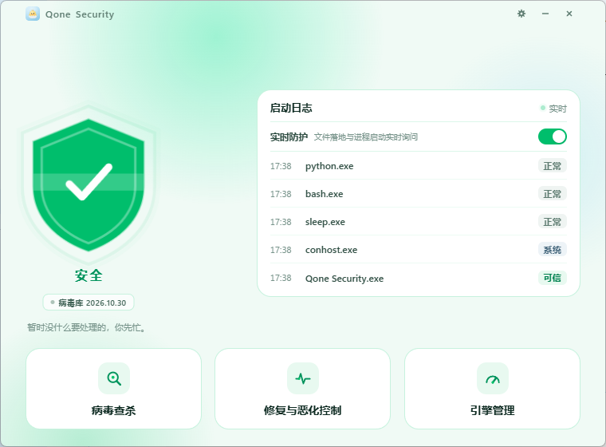
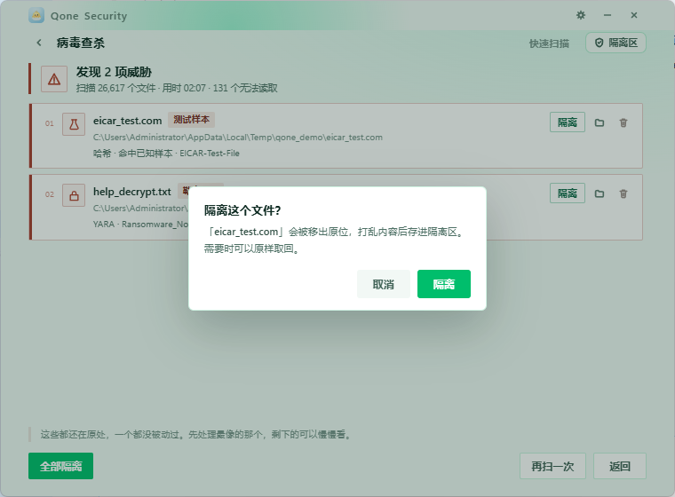
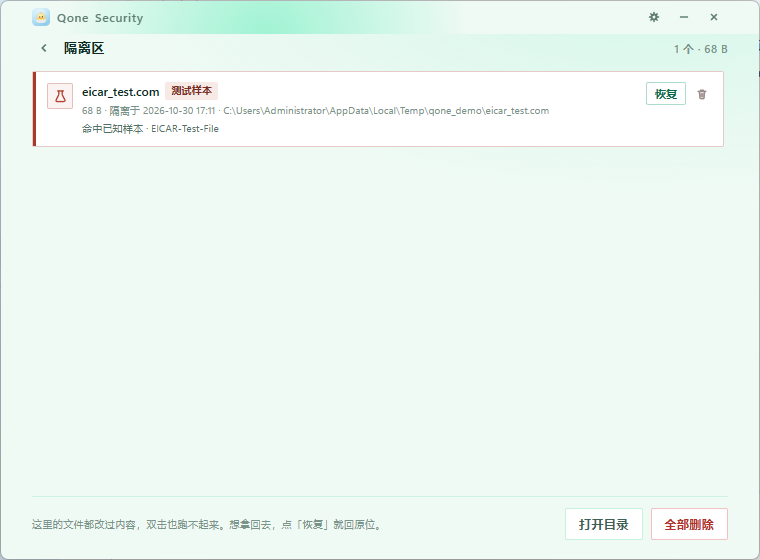

# Qone Security

一个免费、开源（MIT）的 Windows 安全软件。界面 + 自研三层检测引擎 + 隔离区处置。

作者：[Sun2530](https://github.com/Sun2530)

> 本项目仍在持续开发中。当前版本 **1.4.0.0**。

---

## 特性

- **三层检测管线**：哈希（SQLite 内置库）→ YARA 规则（自写）→ PE 结构启发式，另可接入本机 ClamAV（clamd）作为可选联机层。
- **实时防护**：文件落地监控 + 进程启动询问。文件写入即扫，命中即弹窗确认处置。
- **威胁家族分类**：命中后按家族打标（银狐木马 / 后门 / 窃密 / 远控 / 勒索 / 下载器等），不再是一句笼统的「发现病毒」。
- **隔离区处置**：检出文件可隔离、恢复、删除，全程留痕。
- **病毒库自动更新**：规则包通过 GitHub 托管分发，启动时静默检查，三源退让（jsDelivr → raw → Gitee）。
- **托盘驻留**：关闭窗口最小化到右下角托盘，退出需二次确认。

## 界面预览

主界面 —— 实时防护 + 启动日志：



病毒查杀 —— 威胁家族标记 + 隔离确认：



隔离区 —— 检出文件集中处置：



---

## 系统要求

- Windows 10 / 11（x64）
- [Microsoft Edge WebView2 Runtime](https://developer.microsoft.com/microsoft-edge/webview2/)（Win11 自带；Win10 如缺失，安装包会提示安装）

---

## 安装

从 [Releases](https://github.com/Sun2530/Qone-Security/releases) 页面下载最新的 **安装包（.exe）** 并运行。

> 所有发行版均以安装包形式提供，以保证功能完整生效。GitHub 下载页只提供安装包，不提供裸可执行文件。

首次运行可能被 Windows SmartScreen 拦截（本项目暂未做代码签名），点击「更多信息 → 仍要运行」即可。

---

## 病毒库更新机制

规则包（YARA 规则）与程序本体分离更新：

```
本地维护规则 → tools/publish_rules.py 生成清单 → 推上 GitHub 仓库 rules/ 目录
        → 用户端启动时 rulesync.py 自动拉取，三源退让
```

- **托管方**：本项目自己的 GitHub 仓库，不依赖任何第三方服务器。
- **三个更新源**，按序退让：`cdn.jsdelivr.net`（国内最稳）→ `raw.githubusercontent.com`（权威）→ `gitee.com`（备用镜像）。
- **安全校验**：下载的规则视为「代码」，落盘前必须通过三关——SHA-256 与清单一致、拒绝 `include`（可读本机文件）、试编译通过。任何一关不过整包丢弃。
- **分发边界**：只分发本项目自写的 MIT 规则；第三方哈希数据（如 MalwareBazaar）不随项目分发，仅通过用户自己的 Auth-Key 拉取摘要到本机。

维护自己的规则：

```bash
# 出新版本并发布到 rules/ 目录
python tools/publish_rules.py 2026.11.02 "新增银狐侧加载 4 条"

# 重新生成清单（版本沿用上次）
python tools/publish_rules.py
```

---

## 从源码构建

```bash
# 1. 安装依赖
pip install pywebview pefile yara-python pyinstaller

# 2. 生成许可与第三方声明文件
python tools/build_legal.py

# 3. 打包（详见 QoneSecurity.spec）
pyinstaller QoneSecurity.spec
```

打包产物位于 `dist/`。

---

## 项目结构

```
chickguard/
├── main.py            # 入口 + WebView 桥
├── scanner.py         # 扫描管线（哈希 → YARA → 启发式 → clamd）
├── realtime.py        # 实时防护（文件落地监控 + 进程询问）
├── threatcat.py       # 威胁家族分类
├── yrules.py          # YARA 规则加载
├── peheur.py          # PE 结构启发式
├── quarantine.py      # 隔离区处置
├── tray.py            # 托盘驻留
├── rulesync.py        # 病毒库（规则包）更新
├── rules/             # 线上规则包（推上 GitHub 即成为更新源）
├── assets/            # 图标、内置规则、许可文件
└── tools/             # 构建与发布脚本
```

---

## 免责声明

本程序按「现状」提供，不对检出率、误报率或特定用途的适用性作任何担保。任何杀毒引擎都会漏报与误报，检出结果仅供参考。发现可疑文件时，请结合多引擎结果与人工判断再决定处置。

---

## 致谢

本项目基于以下开源组件构建，感谢这些项目与作者：

- [YARA](https://virustotal.github.io/yara/) — BSD 3-Clause
- [yara-python](https://github.com/VirusTotal/yara-python) — Apache License 2.0
- [pefile](https://github.com/erocarrera/pefile) — MIT
- [pywebview](https://pywebview.flowrl.com/) — BSD 3-Clause
- [PyInstaller](https://pyinstaller.org/) — GPLv2-or-later（附例外）
- [CPython](https://www.python.org/) — PSF License

各组件完整的版权声明、许可证全文与分发边界，见 [THIRD-PARTY-NOTICES.md](THIRD-PARTY-NOTICES.md)。

---

## 许可证

[MIT](LICENSE) · Copyright (c) 2026 Sun2530
